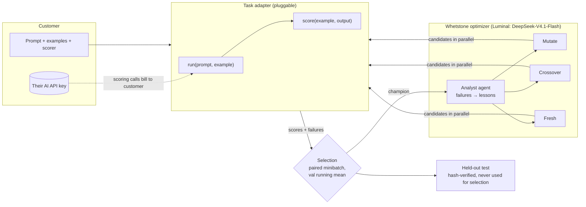

# Whetstone

**A self-improving prompt optimizer.** Give Whetstone a prompt you already use, example inputs, and a way to score the output. A team of AI agents evolves better versions of that prompt over repeated rounds, then proves the improvement on held-out examples the optimizer never saw.

Any business that prompts AI has prompts that could do better: support replies, classification, data extraction, coding agents, internal tools. Whetstone is general-purpose. The task-specific parts live behind a small adapter interface, and the optimizer core knows nothing about any particular task.

## Results

| Task | Baseline → best on **held-out** data | Notes |
|---|---|---|
| **Support-ticket intent classification** (Banking77, 10 confusable intents) | **72.0% → 81.5% accuracy** on all 400 official test examples. **+9.5 pts, 95% CI [+5.5, +13.5]**, a 34% error-rate reduction | Statistically significant. 8 rounds, about $1 total. Train/val drawn from Banking77's train file. |
| **A government contractor's internal AI code-fixing pipeline** (private pilot, dry-run) | **−23% tokens per run**, −22% cost per run, −15% fix time (directional), same fix rate | 3 rounds, 8 candidate prompts; held-out findings, 4 runs each. No pilot code or data is in this repo. |
| Code-fix showcase (5 open-source repos, 110 ruff/bandit findings) | No gain: 93.9% → 90.9% on 33 held-out findings (−3.0 pts, CI [−9.1, 0]) | Honest ceiling result: the reasoning fixer already solves ~94%, leaving no headroom. Reported as-is; the guardrails don't invent gains. |


## How it works



Each round:
1. **Analyze.** An analyst agent turns the current champion's training failures into general lessons.
2. **Propose in parallel.** Several agents generate candidates with different strategies: *mutate* (targeted edits), *crossover* (combine the two best), and *fresh* (a new approach). Measured feedback from earlier rounds goes into their context.
3. **Evaluate.** Every candidate and the champion are scored on the **same fresh training minibatch** (paired comparison).
4. **Select.** The top challengers are re-checked on validation. The champion's validation score is a **running mean** across rechecks, so one lucky measurement can't block every challenger (winner's curse). A candidate is promoted only if it beats that.
5. **Repeat**, then run a **final held-out test**: baseline vs. best on a frozen split whose SHA-256 hash is recorded at creation and verified before evaluation. Code asserts that held-out examples are never used for selection or lessons. Reported with a paired bootstrap 95% CI.

The **objective is configurable.** It can maximize success, or minimize tokens, time, or cost while keeping success within a set margin of baseline (`--objective tokens:min --constraint "success>=-0.02:rel"`). That's how the pilot targeted cost while holding the fix rate.

## Task adapters

| Adapter | What it optimizes | How it's scored |
|---|---|---|
| `banking77` | Classifier system prompt | Exact label match (model "thinking" off, as a production classifier runs) |
| `codefix` | Fixer system prompt for scanner findings | Fix applied in a throwaway copy; the finding must vanish on re-scan (and not just move), no new findings, repo tests pass; `noqa`/`nosec` rejected |
| `pilot*` | Any external pipeline's prompt (private) | Plugged in from a git-ignored folder; runs never leave the machine |

Adding a task is one class with four methods: `starting_prompts`, `examples`, `run`, `score`.

## Product and AWS

- **Bring your own key:** the optimizer's agents run on our Luminal account. **Scoring** (usually over 90% of a run's tokens) runs on the **customer's own AI provider key**, against the model they use in production.
- **Amazon Cognito** handles customer sign-in. The verified ID token's `sub` is the billing identity.
- **AWS KMS** encrypts customer API keys at rest, bound to `{customer_id, key_id}` with encryption context. Keys are never logged or returned, and can be revoked.
- **Amazon DynamoDB** stores run history (`whetstone-runs`) and accounts, the run counter and the usage log (`whetstone-accounts`).
- **AWS Lambda + Function URL** (container image in **Amazon ECR**) serves the public read-only dashboard. Its IAM role can only read run history.
- **AWS App Monetization (private beta)** handles plans, metering (`optimization_run`), a fail-closed entitlement check before every run, and the hosted pricing, checkout and billing portal. Integrated over signed HTTP from Python (sandbox).
- **Pricing:** Founding **$49/mo** (locked 12 months, 4 runs), Standard **$199/mo** (10 runs), **$5** per extra run. A cost estimate on the customer's key and a confirmation are required before every run, with a per-run spending limit.

## Run it

```bash
python -m venv .venv && .venv/Scripts/activate      # macOS/Linux: source .venv/bin/activate
pip install -r requirements.txt
cp .env.example .env                                 # add LUMINAL_API_KEY / BASE_URL / MODEL
python -m whetstone.run --task banking77 --rounds 8  # resumable: --resume <run_id>
python -m whetstone.final_eval <run_id>             # held-out test with paired bootstrap CI
python -m whetstone.web                              # dashboard at http://localhost:8000
```

Other commands: `python -m whetstone.status`, `python -m whetstone.aws_setup` (DynamoDB, KMS, Cognito), `python -m whetstone.sync`, `python -m whetstone.customers add <email>`, `bash scripts/deploy_aws.sh`.

## Honest limitations

- **Small held-out sets are directional.** Banking77's 400-example result is significant. The pilot used 4 runs per prompt, so its time improvement isn't significant (its token improvement had non-overlapping ranges).
- **Prompts can get longer.** The best classifier prompt is about 11× longer (label definitions), so per-call cost went up even as accuracy rose. The objective can trade this off explicitly; we haven't run that tradeoff yet.
- **No headroom, no gain.** On the code-fix showcase the baseline was already at 95.5%, and the optimizer correctly found nothing better.
- **Sandboxing is process-level.** Model-written code runs in throwaway copies with timeouts and a scrubbed environment, but not in a container. The memory cap applies only on Linux/macOS.
- **Billing is a private-beta sandbox.** Payments are test-mode.
- **Luminal rate limits and outages** (503s) were frequent during the event. The loop retries, resumes, and never scores an infrastructure error as a wrong answer.
- **Hosted scoring** (where we pay for scoring tokens) is a roadmap item, not offered.

Built in one day at a hackathon. Data: [Banking77](https://github.com/PolyAI-LDN/task-specific-datasets) (CC-BY-4.0); code-fix repos are permissively licensed (see `data/codefix/repos.yaml`).
